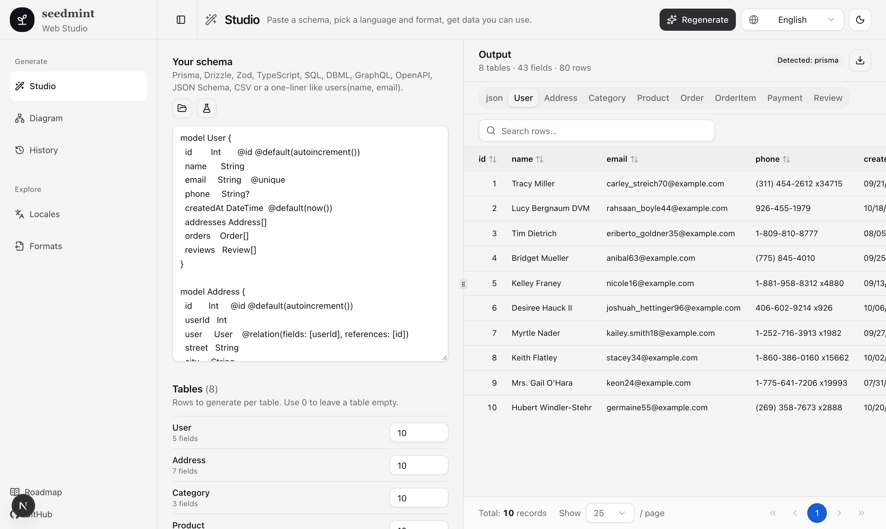
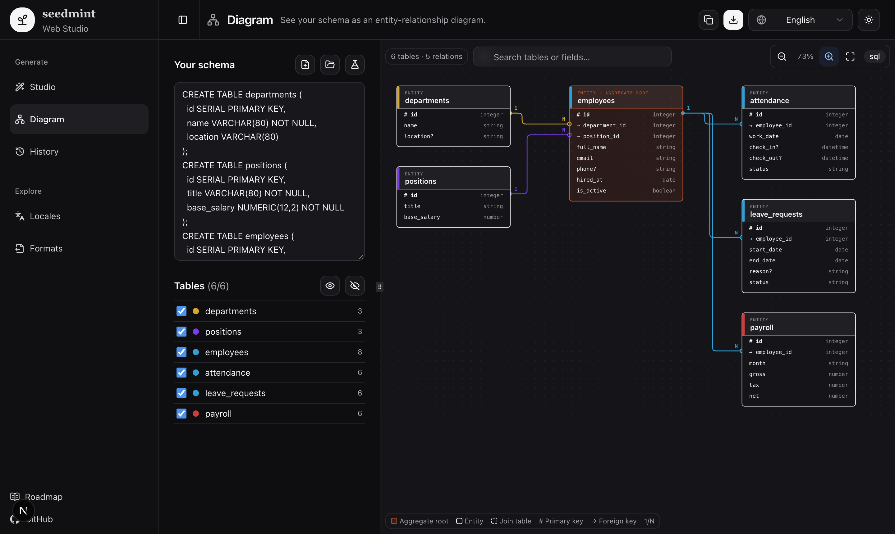

# seedmint

[English](README.md) · [Tiếng Việt](README.vi.md) · [简体中文](README.zh-CN.md) · [日本語](README.ja.md) · [한국어](README.ko.md) · [Español](README.es.md)


[](https://github.com/poalninhphuoc/seedmint/actions/workflows/ci.yml) [](LICENSE) 

> Paste a schema. Get realistic sample data in any language and format. Built so vibe-coded apps never look empty.

Open-source seed data and mock data generator for Prisma, Drizzle, Zod, SQL and JSON Schema, with localized names, addresses and phone numbers.

**Live demo:** https://seedmint.vercel.app

**Status:** early. The CLI and library work (Prisma, Drizzle, Zod, TS, SQL, JSON Schema in; JSON, CSV, SQL, `seed.ts`, AI prompt out). The Web Studio (Next.js + shadcn/ui, 6 UI languages) also works. The docs site, direct DB insert and AI engine are planned (see the roadmap).

## Why

AI-built prototypes (Claude Code, Cursor, v0, Lovable) often ship with empty tables or "Lorem ipsum" and `John Doe`. Reviewing a UI without believable data hides layout bugs, i18n bugs and edge cases. seedmint turns the structure you already have into data you can actually review.

<p align="center">
  
</p>

## What it does

- **Paste any structure:** TypeScript `interface`/`type`, Zod, Prisma, Drizzle, SQL `CREATE TABLE`, JSON sample, OpenAPI (JSON or YAML), DBML, GraphQL, CSV, or a one-line description like `users(name, email, phone, address, created_at)`.
- **See the schema:** the Web Studio draws an ER diagram with coloured relation lines, click-to-highlight, draggable tables, search and zoom, and exports Mermaid or SVG.
- **Understands fields and relations:** `email`, `phone`, `price`, `avatar` get the right kind of value; `orders.user_id` points to a real `users.id`.
- **Many output formats:** JSON, JSONL, CSV, SQL `INSERT`, Prisma/Drizzle `seed.ts`, typed `mock.ts`, MSW handlers, Playwright/Vitest fixtures, Excel.
- **Many locales:** `vi`, `en`, `ja`, `ko`, `zh`, `th`, `id`, `fr`, `de`, `es`. Names, addresses, phones, currency, dates and IDs follow local rules. Mix locales in one table to test i18n.
- **Repeatable:** fixed seeds give the same data every run.
- **Edge cases on demand:** empty strings, very long names, emoji, RTL text.
- **Built for AI tools:** a Claude Code skill, `AGENTS.md`/`CLAUDE.md`, and a `prompt` output you can paste into Cursor or Claude Code. An MCP server and an opt-in AI engine for business-specific columns are planned.

## Usage

```bash
# in a project that has prisma/schema.prisma, a Drizzle schema, Zod schemas or a .sql file
npx seedmint init                       # detects the ORM, writes seedmint.config.ts
npx seedmint generate --locale=vi       # writes prisma/seed.ts (or your configured output)

# one-off, no config
npx seedmint schema.sql --locale vi,en --rows users=50,orders=200 --format sql
echo 'users(name, email, phone?, avatar:image)' | npx seedmint - -l vi -n 10
```

**Inputs:** Prisma, Drizzle, Zod, TypeScript interfaces, SQL DDL, JSON Schema, a JSON sample, or one-line `table(field, field:type)`.
**Outputs (`--format`):** `json`, `jsonl`, `csv`, `sql`, `ts` (typed mock), `prisma` (`seed.ts`), `drizzle` (`seed.ts`), `prompt` (Markdown with schema, sample rows and instructions to paste into Cursor / Claude Code).
**Other options:** `--seed`, `--from`, `--edge-cases`, `--out <file|dir>`.

```ts
// seedmint.config.ts (written by `init`)
import type { SeedmintConfig } from "seedmint";

const config: SeedmintConfig = {
  schema: "prisma/schema.prisma",
  locale: ["vi", "en"],
  rows: { User: 50, "*": 20 },
  seed: 42,
  format: "prisma",
  out: "prisma/seed.ts",
};
export default config;
```

```ts
import { parseSchema, mint, render } from "@seedmint/core";

const schema = parseSchema(prismaOrSqlOrZod);
const data = mint({ schema, locale: ["vi", "en"], rows: 50, seed: 42 });
const [{ content }] = render(data, "prompt", schema, { locale: "vi", seed: 42 });
```

Tables are generated parents first, so foreign keys (explicit, or `user_id` pointing at `users`) always reference real rows. Output is repeatable for the same seed within a day (relative dates are based on today).

## Repository layout

```
packages/core   @seedmint/core: parsers, generator, formats, locales
packages/cli    seedmint: the CLI (bundles core)
apps/web        Web Studio: Next.js App Router, Tailwind, shadcn/ui, next-intl (en, vi, zh-CN, ja, ko, es)
```

Develop with `pnpm install && pnpm typecheck && pnpm build && pnpm test` (Turborepo). AI coding agents: see [AGENTS.md](AGENTS.md).

## Web Studio

```bash
pnpm install
pnpm --filter @seedmint/web dev   # http://localhost:3000
```

| Studio | Diagram (dark theme) |
|---|---|
|  |  |

Pages: **Studio** (generate and export), **Diagram** (ER view of your schema, see [docs/diagram.md](docs/diagram.md)), **History**, **Locales** and **Formats**. Eleven sample schemas are one click away from the sample menu.

Set `NEXT_PUBLIC_SITE_URL` to your public origin so canonical, hreflang and sitemap URLs are correct. The UI is available in English, Tiếng Việt, 简体中文, 日本語, 한국어 and Español.

## Roadmap

See [docs/roadmap.md](docs/roadmap.md). MVP: TypeScript/Zod/SQL parsers, `vi` + `en`, JSON/CSV/SQL output, one-page Next.js playground.

## Docs

- [Architecture](docs/architecture.md)
- [Locales](docs/locales.md)
- [Roadmap](docs/roadmap.md)
- [Claude Code skill](.claude/skills/seedmint/SKILL.md)
- [Contributing](CONTRIBUTING.md) · [Security](SECURITY.md) · [Agents guide](AGENTS.md)

## License

[MIT](LICENSE)

## Keywords

sample data generator · seed data · mock data · test data · Prisma seed · Drizzle seed · Zod mock · SQL INSERT generator · faker · localized fake data · vibe coding · Claude Code · Cursor
