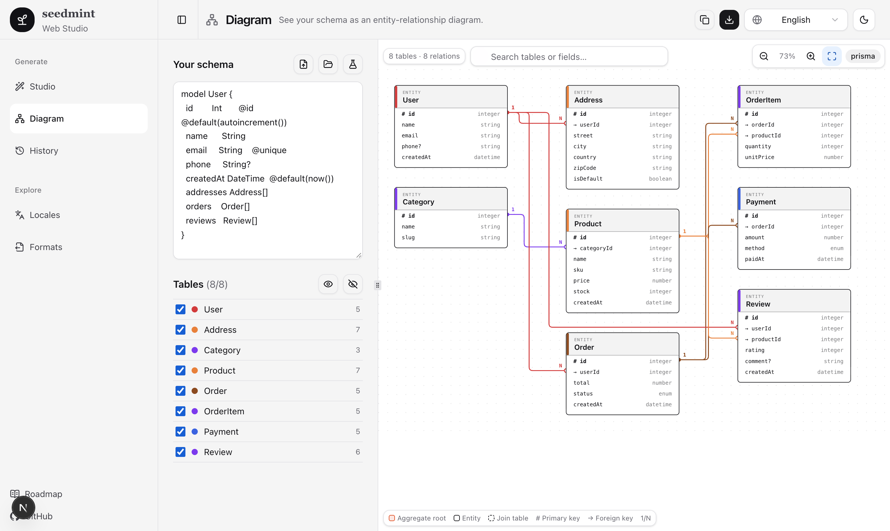

# seedmint

[English](README.md) · [Tiếng Việt](README.vi.md) · [简体中文](README.zh-CN.md) · [日本語](README.ja.md) · [한국어](README.ko.md) · [Español](README.es.md)

> Dán cấu trúc dữ liệu, nhận data mẫu thật đúng ngôn ngữ và định dạng. Để app vibe-code không bao giờ trống trơn.

Công cụ mã nguồn mở tạo dữ liệu mẫu (seed data, mock data) từ schema Prisma, Drizzle, Zod, SQL. Có dữ liệu tiếng Việt thật: tên, địa chỉ, số điện thoại.

**Dùng thử:** https://seedmint.vercel.app

**Trạng thái:** đã dùng được, còn sớm. CLI, thư viện và Web Studio (6 ngôn ngữ, sơ đồ ER, 11 schema mẫu) đã chạy. Vào: Prisma, Drizzle, Zod, TypeScript, SQL, DBML, GraphQL, OpenAPI, JSON Schema, CSV; ra: JSON, JSONL, CSV, SQL, Excel, `seed.ts`, `mock.ts`, prompt cho AI. Đang lên kế hoạch: MSW, fixtures Playwright, MCP server, trang tài liệu, ghi thẳng vào database và AI engine.

<p align="center">
  
</p>

## Vì sao

Prototype do AI dựng thường chỉ có bảng trống hoặc `John Doe`. Không có data tin được thì khó review giao diện, lỗi đa ngôn ngữ và ca biên. seedmint biến cấu trúc bạn đã có thành data dùng được ngay. Hỗ trợ TypeScript, Zod, Prisma, Drizzle, SQL, DBML, GraphQL, OpenAPI, JSON; hiểu quan hệ khóa ngoại; có seed cố định để lặp lại kết quả; có skill cho Claude Code (MCP server đang lên kế hoạch).

## Dùng nhanh

- `npx seedmint schema.ts --locale vi,en --rows 50 --format json`
- JSON · CSV · SQL · seed.ts · mock.ts · MSW · Excel
- vi · en · ja · ko · zh · th · id · fr · de · es

## Web Studio

Chạy giao diện quản trị (Next.js, shadcn/ui, đa ngôn ngữ):

```bash
pnpm install
pnpm --filter @seedmint/web dev   # http://localhost:3000
```

Giao diện có 6 ngôn ngữ: English, Tiếng Việt, 简体中文, 日本語, 한국어, Español.

Các trang: **Studio** (tạo và xuất dữ liệu), **Sơ đồ** (xem schema dạng ER, kéo thả bảng, xuất Mermaid/SVG, xem [docs/diagram.md](docs/diagram.md)), **Lịch sử**, **Ngôn ngữ dữ liệu**, **Định dạng**. Có 11 schema mẫu trong menu mẫu.

## Lộ trình và đóng góp

[docs/roadmap.md](docs/roadmap.md) · [CONTRIBUTING.md](CONTRIBUTING.md) · [MIT](LICENSE)

## Từ khóa

tạo dữ liệu mẫu · seed data · mock data · dữ liệu giả tiếng Việt · Prisma seed · Drizzle seed · Zod · SQL INSERT · faker · dữ liệu test · vibe coding · Claude Code · Cursor
