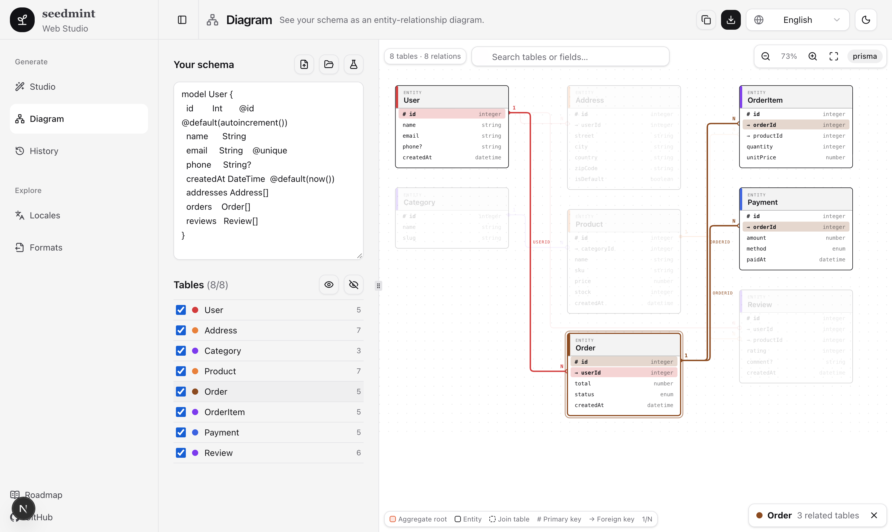
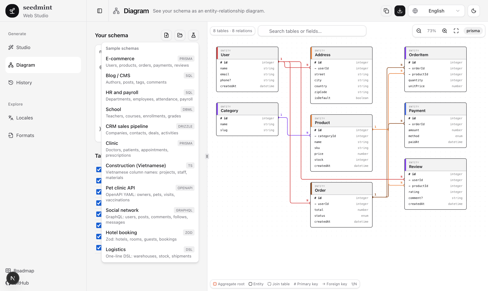

# Diagram (ER view)

The **Diagram** page of the Web Studio (`/diagram`) draws a schema as an entity-relationship diagram. It uses the same parsers as the CLI and Studio, so every input format works: Prisma, Drizzle, Zod, TypeScript, SQL, DBML, GraphQL, OpenAPI, JSON Schema, CSV and the one-line DSL. Nothing leaves the browser tab except the parse call to the app's own server action.

## Reading the diagram

- **One box per table.** The header shows the kind of table and its name; each row is a field with its type on the right.
- **Field markers:** `#` primary key, `→` foreign key, `?` optional.
- **Table kinds** (`apps/web/src/lib/er-layout.ts`):
  - *Root*: a table that other tables point at but that points at none (orange outline).
  - *Entity*: any other table.
  - *Join*: a table made only of two or more foreign keys plus an optional id, such as `post_tags` (dashed outline).
- **One line per foreign key.** Parents sit on the left, children on the right. Lines are elbow-shaped with rounded corners, each in its own colour, with `1` at the parent end and `N` at the child end. A composite key (`FOREIGN KEY (a, b)`, Prisma `fields: [a, b]`) is one line with a bracket over its key rows, labelled `a + b`.
- **Groups.** When tables come from two or more schemas or modules (SQL `billing.invoice`, Prisma `@@schema("billing")`, DBML `Table billing.invoice`), each group is arranged on its own and drawn inside a dashed, labelled frame that follows its tables when you drag them. A single group, or none, draws no frame.
- **Relations come from** explicit references (`REFERENCES`, `@relation`, `[ref: > …]`, `.references()`) and from the `*_id` / `*Id` naming convention when no explicit link exists.

## Working with it

| Action | How |
|---|---|
| Highlight relations | Click a table: connected tables and their key columns stay lit, the rest fade, and each line shows its column name. Click again or the empty canvas to clear. |
| Rearrange | Drag a table. The lines re-route as you move it. The reset button restores the automatic layout. |
| Pan | Hold the mouse on empty canvas and drag, or scroll. |
| Zoom | Zoom buttons, or Ctrl/⌘ + wheel (also trackpad pinch) around the cursor. The fit button scales the whole diagram to the pane. |
| Find | The search box rings tables whose name or any field matches. |
| Show / hide | Tick tables in the list on the left, or show / hide all. Hidden tables and their lines leave the canvas. |

## Getting a schema in

- Type or paste in the editor.
- **Import files** or **Import folder**: the same scanner as the CLI picks the schema files (a schema split over many files is read as one; an OpenAPI folder uses its first spec).

- **Samples** menu: eleven ready-made schemas of 5 to 8 tables each (e-commerce, blog, HR, school, CRM, clinic, construction with Vietnamese columns, pet-clinic OpenAPI, social GraphQL, hotel booking with Zod, logistics with the DSL). They live in `apps/web/src/lib/sample.ts`.

The same diagram in dark mode, here with the HR sample:

## Exporting

- **Copy Mermaid**: an `erDiagram` block you can paste into GitHub, GitLab, Notion or any Mermaid renderer. Optional foreign keys use `|o`, required ones `||`.
- **Download SVG**: the current diagram, including dragged positions, as a standalone vector file. It is always exported with a light palette (white boxes, dark text), whatever theme the page is in.
- **Download PNG**: the same light-palette diagram rasterised at 2x on a white background.

## Notes for contributors

- Layout and routing are pure functions in `apps/web/src/lib/er-layout.ts` (`layoutEr`, `routeEdges`, `withOffsets`, `toMermaid`) and are covered by `apps/web/test/er-layout.test.ts`. Keep them free of React so they stay testable.
- The SVG itself is `apps/web/src/components/er-diagram.tsx`; the page, toolbar, table list and export are in `diagram-view.tsx`.
- Icon buttons use the shared `IconButton` (label shows as a tooltip). Every new label goes into all six catalogs under `diagramPage` in `apps/web/src/messages/`; a test enforces parity.
- A new sample needs at least 5 tables and a foreign key; `apps/web/test/samples.test.ts` checks parsing, detection and generation for each.
